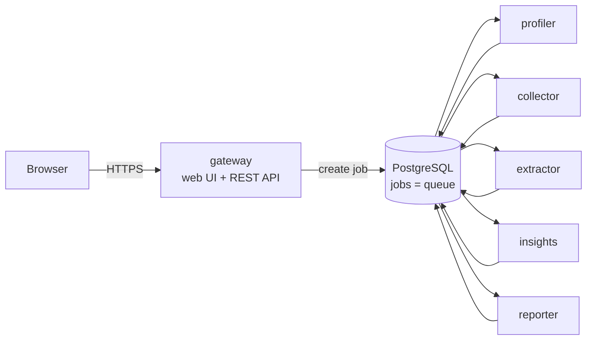

# ArchangX Pipeline

A small web application built as microservices, in the same shape as the Pilr/Immofax backend
(a request flows through profiler → collector → extractor → insights → reporter) but self-contained:
no third-party APIs, no external queue. Submit text in the web page and watch five services process it
in turn, each recording how long its stage took.



| Service | Does | Consumes → produces |
|---|---|---|
| `gateway` | Web page, `POST/GET /api/jobs`, `/api/stats`, `/healthz` | creates `queued` jobs |
| `profiler` | Validates and measures the input | `queued` → `profiled` |
| `collector` | Splits it into documents (heaviest stage) | `profiled` → `collected` |
| `extractor` | Top words, numbers, email addresses | `collected` → `extracted` |
| `insights` | Rules turn extractions into findings | `extracted` → `analyzed` |
| `reporter` | Writes the final report | `analyzed` → `done` |

The `jobs` table is also the queue: a worker claims the oldest job in its input status with one conditional
`UPDATE`, so replicas never take the same job and there is no broker to run. `WORK_MS` adds simulated CPU work
per stage (default 200 ms; the collector does twice that) so the system can be load-tested like a real pipeline.

## Run it locally
```bash
python -m venv .venv && .venv/Scripts/pip install -r requirements-dev.txt   # (bin/ on macOS/Linux)
.venv/Scripts/python -m pytest -q tests                                     # 5 tests, SQLite
docker compose up --build                                                   # full system, http://localhost:8000
```
Without Docker: start `uvicorn services.gateway.main:app` and `python -m services.<stage>.main` for each stage;
they share `./pipeline.db` (SQLite).

## Deploy to GCP (GKE Autopilot)
Needs the Google Cloud CLI (`gcloud auth login`), `kubectl`, and billing on the project.
```bash
PROJECT=agile-airship-512819-u5 HOST=pipeline.archangx.com ./deploy/gcp.sh
```
The script enables the APIs, creates an Artifact Registry repo and an Autopilot cluster in `northamerica-northeast1`
(Montreal), builds the six images with Cloud Build, creates a random database password as a Kubernetes Secret,
reserves a global static IP and applies `k8s/`. It is safe to re-run; each run deploys a new image tag.

**DNS (once):** at the DNS provider for `archangx.com`, add an `A` record `pipeline.archangx.com → <IP the script prints>`.
The Google-managed certificate turns Active 15-60 min after the name resolves; then https://pipeline.archangx.com serves the app.
A subdomain keeps the main archangx.com website untouched.

**Costs (estimate, check the GCP pricing calculator):** about 2.5 vCPU and 4 GiB requested at rest
(gateway ×2, five workers, PostgreSQL) on Autopilot, plus one HTTPS load balancer: roughly US$110-150/month while
deployed. GKE's free tier covers the management fee of one Autopilot cluster. Stop the cost with
`PROJECT=agile-airship-512819-u5 ./deploy/teardown.sh` (deletes the cluster, IP and images; data is lost).

## Layout
`common/` shared job store (`db.py`), worker loop (`worker.py`), stage logic (`stages.py`) ·
`services/<name>/` one entry point per microservice · `Dockerfile` one image per service (`--build-arg SERVICE=`) ·
`k8s/` namespace, PostgreSQL, Deployments, autoscalers, HTTPS ingress · `deploy/` Cloud Build config, deploy and teardown ·
`tests/` pipeline, claim safety, API, manifest checks.
