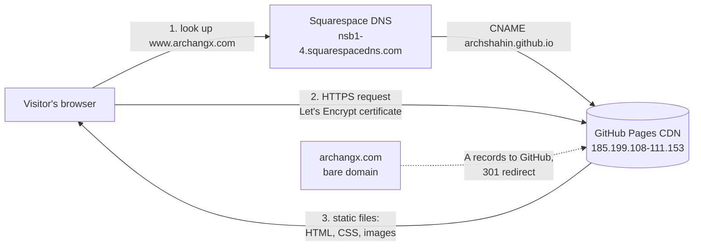
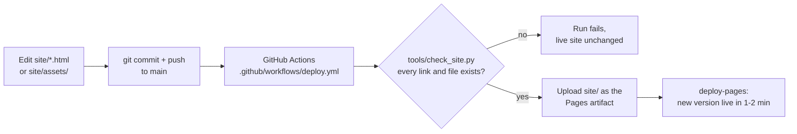
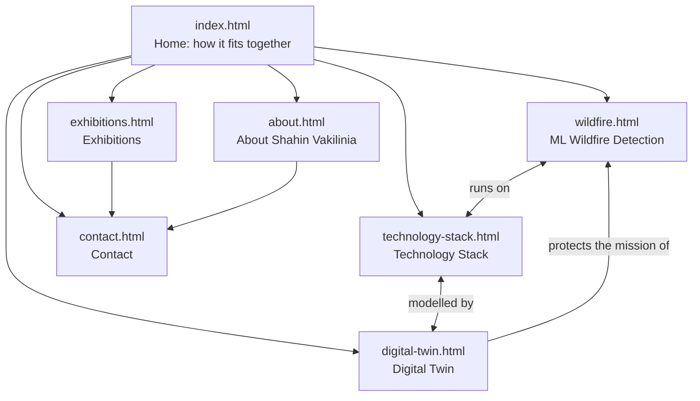

# ArchangX website: architecture

**What it is.** www.archangx.com is a static website of seven pages, published by GitHub Actions to GitHub
Pages and served over HTTPS through GitHub's CDN. DNS stays with Squarespace (the domain registrar).
There is no server, no database, and no third-party script, font or tracker.

## 1. Request path: a visitor opens the site



| Name | DNS record (Squarespace) | Result |
|---|---|---|
| `www.archangx.com` | `CNAME archshahin.github.io` | serves the site |
| `archangx.com` | `A 185.199.108.153`, `.109.153`, `.110.153`, `.111.153` | GitHub redirects to `https://www.archangx.com` |
| `@` MX / TXT | Google Workspace (`smtp.google.com`, SPF, DKIM) | email, unaffected by the website |

## 2. Publishing path: a change goes live



The check runs before every publish, so a broken link or a missing image stops the deploy instead of reaching
visitors. Concurrency is `cancel-in-progress`: if two pushes land close together, only the newest is published.

## 3. Site map



The content model mirrors the company's own architecture: **ML Wildfire Detection is the application on top**,
running on the **Technology Stack**, which the **Digital Twin** models. Those three pages cross-link through a
"Connected" strip, and the home page draws the same structure.

## 4. Repository layout

```
site/                      everything that is published
  index.html ... contact.html   the seven pages (plain HTML, shared header, nav and footer)
  assets/style.css         one stylesheet for all pages (brand palette and components)
  assets/logo.png          full logo, light backgrounds      (from Logo/Files/logo, 900 px)
  assets/logo-dark.png     full logo with white wordmark, dark backgrounds
  assets/emblem*.png       wings-and-flame emblem (section marks, header, watermarks)
  assets/favicon.ico, apple-touch-icon.png
  CNAME                    www.archangx.com (tells GitHub Pages the custom domain)
  .nojekyll                serve files as-is, no Jekyll processing
tools/check_site.py        link and file checker, run locally and in CI
.github/workflows/deploy.yml   the publish pipeline
docs/                      this documentation
```

## 5. Components and their responsibilities

| Component | Responsibility | Owner / where to change it |
|---|---|---|
| Pages (`site/*.html`) | Content of each page | edit the HTML, push |
| Stylesheet (`site/assets/style.css`) | Look and layout of every page | edit, push |
| Contact form (`contact.html`) | Composes an email in the visitor's own mail app (`mailto:`); nothing is sent or stored by the site | inline script on the page |
| Link checker (`tools/check_site.py`) | Blocks a deploy with a broken link or missing file | Python, no dependencies |
| GitHub Actions workflow | Check, package and publish on every push to `main` | `.github/workflows/deploy.yml` |
| GitHub Pages | Hosting, CDN, HTTPS certificate (Let's Encrypt), bare-domain redirect | repo Settings → Pages |
| Squarespace DNS | Points the domain at GitHub; keeps the Google Workspace email records | Squarespace → Domains → archangx.com → DNS |

## 6. Security and privacy

- No server-side code, database or user accounts: nothing to breach or patch on our side.
- No cookies, analytics, trackers, external fonts or scripts: no third party sees the visitors.
- The contact form never transmits data; it opens the visitor's own email app with a pre-filled message.
- HTTPS everywhere: Let's Encrypt certificate for `www.archangx.com` and `archangx.com`, renewed by GitHub;
  "Enforce HTTPS" is on, so `http://` redirects to `https://`.
- The domain is verified on the ArchShahin account, so no other GitHub account can publish under it.
- Publishing requires push access to `ArchShahin/archangx-website`; the workflow has only the `pages: write`
  and `id-token: write` permissions it needs.

## 7. Cost

US$0. GitHub Pages hosting, the CDN and the certificate are free for a public repository; the domain
registration (Squarespace, renews 2027-07-28) is the only cost.

See also: [DEPLOYMENT.md](DEPLOYMENT.md) (DNS, HTTPS, first-time setup), [OPERATIONS.md](OPERATIONS.md)
(updating content, troubleshooting, rollback), [DECISIONS.md](DECISIONS.md) (why this design).
