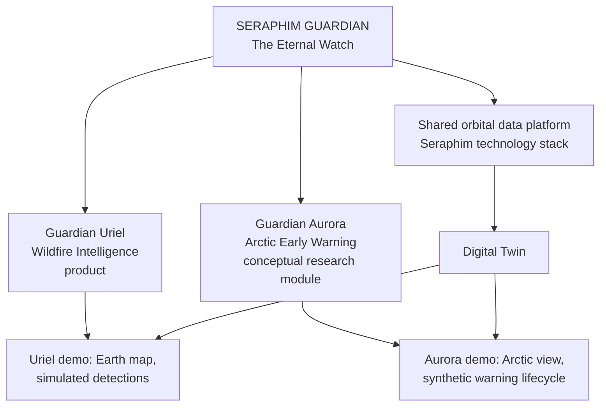
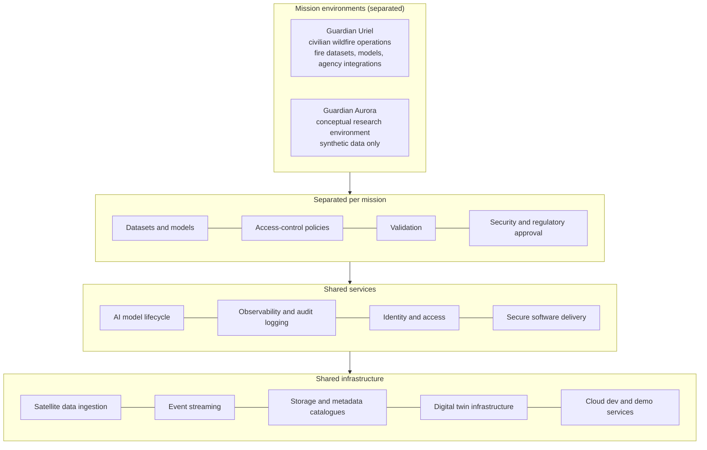
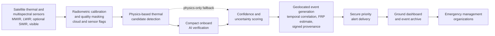
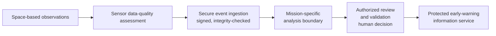
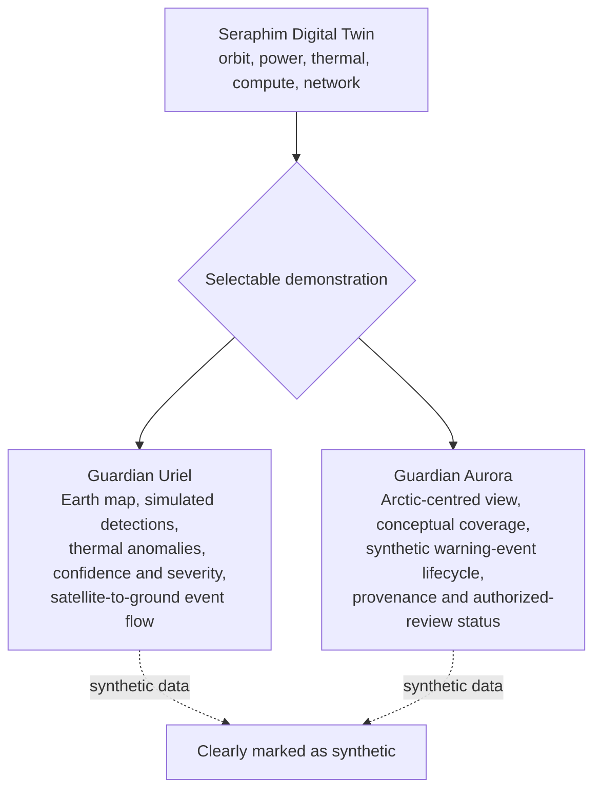
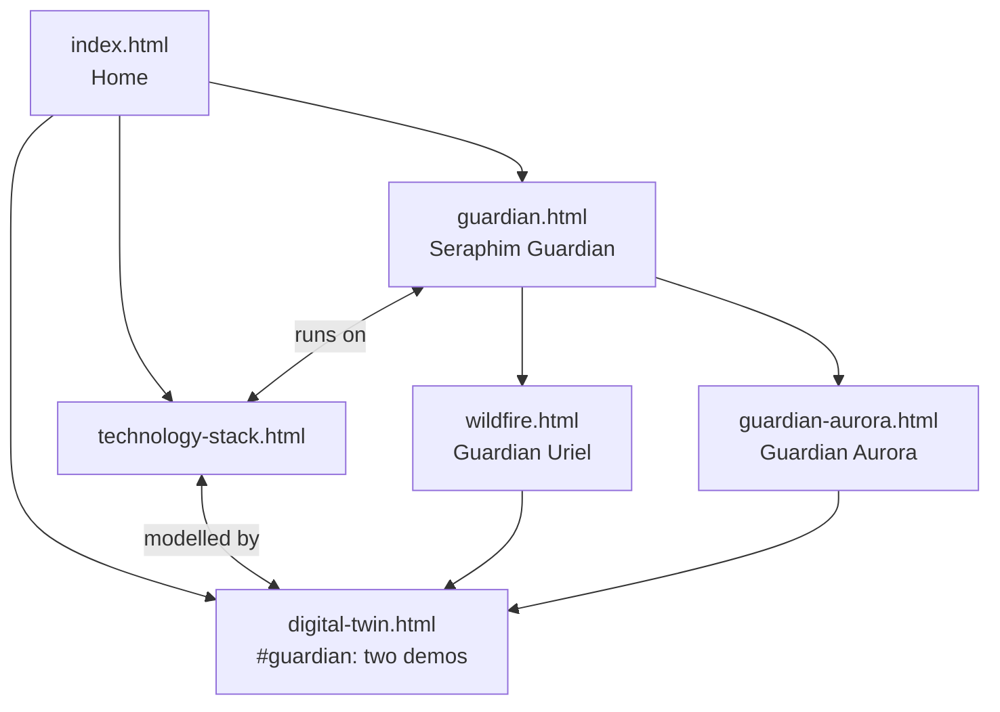

# Seraphim Guardian: The Eternal Watch

Product family introduced on the website on 2026-11-08. This document records the brand language, the product
hierarchy, the architecture the pages describe, and the rules the pages must follow.

**Scope.** This repository is the public website only. The research codebase, the Digital Twin application, the
Codex documentation set (`Seraphim_Guardian/README.md`, `PRODUCT_VISION.md`, ... `GITHUB_GCP_DEVOPS.md`) and the
GitHub-to-GCP delivery pipeline live in the Space Data Centre repository and are maintained there.

## Brand language

| | |
|---|---|
| Family | **SERAPHIM GUARDIAN** — *The Eternal Watch* |
| Guardian Uriel | Wildfire Intelligence. Tagline: *Celestial Intelligence Protecting Life on Earth.* Line: *Intelligence that sees the first spark.* |
| Guardian Aurora | Arctic Early Warning (conceptual research module). Tagline: *The Northern Light of Eternal Vigil.* Line: *Vigilance beyond the northern horizon.* |
| Unifying statement | *From the first spark upon the Earth to the distant horizons of the Arctic sky, Seraphim Guardian envisions a future where celestial intelligence serves awareness, protection, and the preservation of life.* |

Colours (tokens in `site/assets/style.css`): deep navy and midnight blue for space (the existing `--night` band and the
Earth gradient), celestial gold `--gold`, Uriel amber `--uriel`, Aurora polar blue `--polar` and aurora green
`--aurora-green`. The symbolism is stated as a posture (a constant watch), never as a technological capability.

## Pages

| Page | File | Role |
|---|---|---|
| Seraphim Guardian | `site/guardian.html` | Landing page: identity, mission statement, two product cards, shared platform, digital twin demos, readiness, partnership |
| Guardian Uriel | `site/wildfire.html` | Wildfire intelligence product (URL kept from the former "ML Wildfire Detection" page) |
| Guardian Aurora | `site/guardian-aurora.html` | Conceptual, non-operational research module |
| Digital Twin | `site/digital-twin.html#guardian` | The two selectable demonstrations |

## Product hierarchy

## Shared platform architecture

Rule: civilian and defence-related workloads are never mixed without explicit authorization and an approved
data-classification policy.

## Guardian Uriel processing pipeline

Readiness labels used on the pages: **Designed** (written down in the research), **Prototype** (running in the
digital twin on synthetic data), **Research target** (not yet built). No flight validation has taken place;
detection performance is published only with verified evidence.

## Guardian Aurora conceptual workflow

Rules for Aurora, on every page and demonstration:
- Represented as a conceptual, non-operational research module.
- No operational target tracking, interception guidance, launch-location estimation or engagement functionality.
- No realistic trajectories, targeting solutions or interception calculations in the twin.
- Synthetic, non-sensitive demonstration data only.
- No detection-performance claims without verified evidence.

## Digital Twin integration

## Website site map after this change

